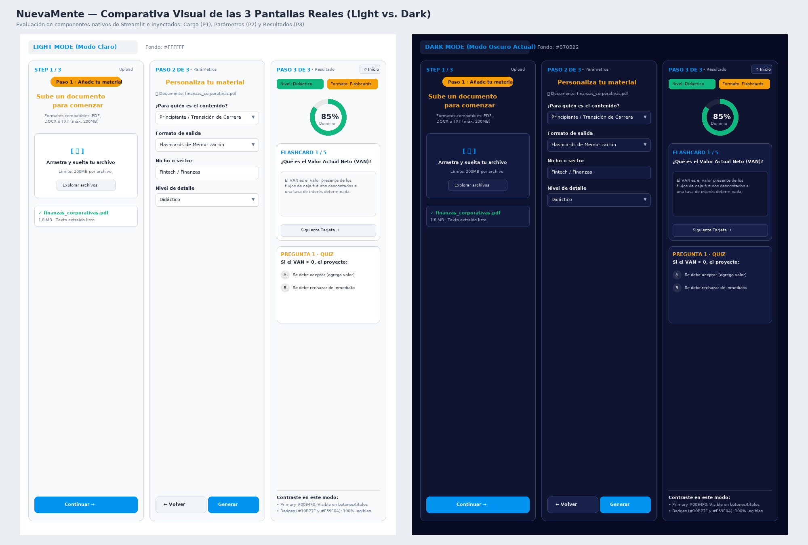
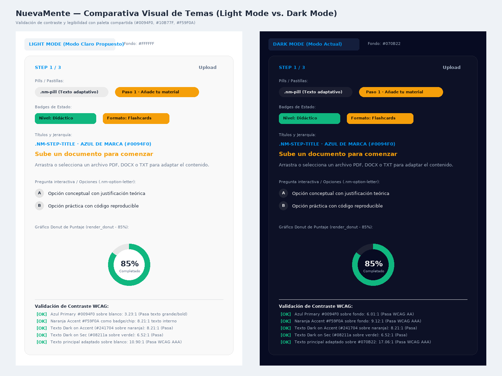
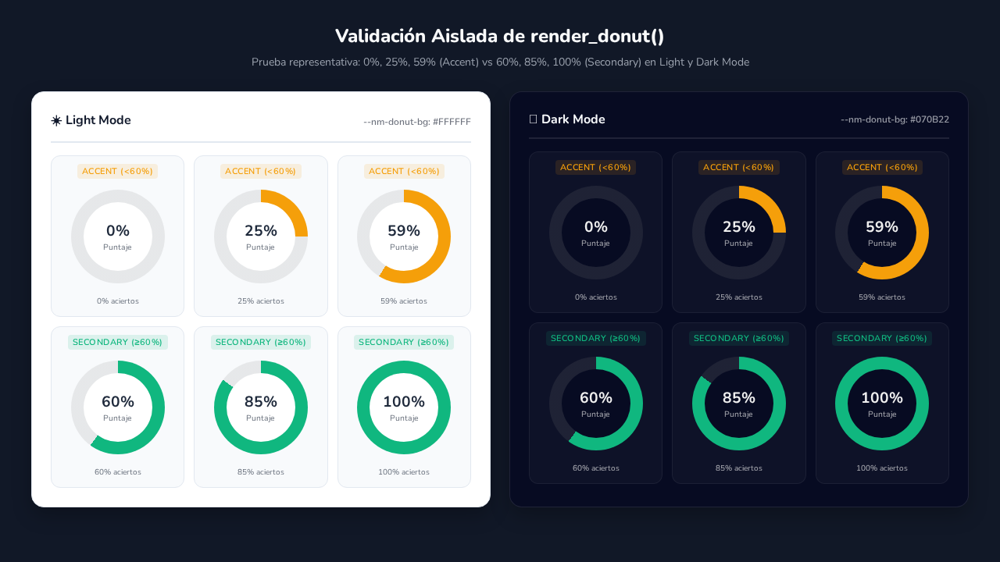
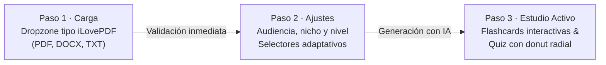
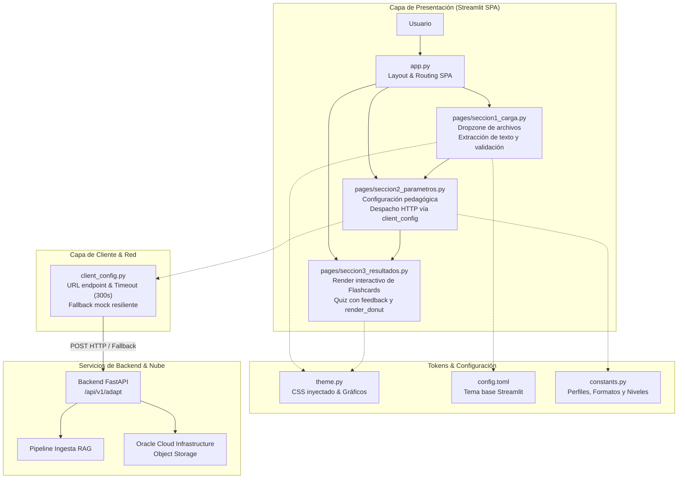
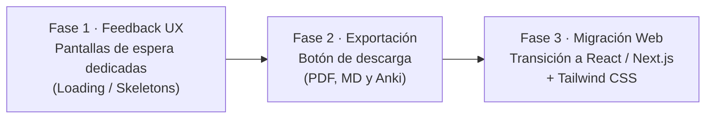

# 🧠 NuevaMente — Frontend & Interactive Learning Interface

> **Transformando documentación técnica en experiencias de microaprendizaje adaptativo mediante IA.**  
> Interfaz web interactiva tipo SPA desarrollada con **Streamlit**, diseñada bajo principios de **Frontend Engineering & UI/UX Design** por el equipo de desarrollo frontend.

[](https://streamlit.io/)
[](https://www.python.org/)
[](https://docs.pydantic.dev/)
[](#fundamentos-diseno)
[](#tokens-color)
[](https://www.nocountry.tech/)

---

<a id="vision-general"></a>
## 📌 Visión del Producto

**NuevaMente** es una plataforma orientada a estudiantes y profesionales del sector tecnológico que necesitan asimilar documentación técnica densa sin caer en la fatiga cognitiva del estudio tradicional.

El equipo frontend asumió de forma integral la **arquitectura técnica** y el **diseño de producto UI/UX**, planteando una experiencia de usuario inspirada en herramientas utilitarias de alta adopción (*como iLovePDF*): un flujo lineal de 3 pasos (*Carga ➔ Configuración ➔ Resultado*), reactivo, directo y en una sola pantalla.

---

<a id="evidencia-visual"></a>
## 📸 Evidencia Visual & Prototipado de Interfaz

> ℹ️ **Nota sobre el entorno de ejecución:** Las capturas a continuación documentan el prototipado y validación de diseño de la interfaz. En el entorno real de Streamlit, la plataforma se ejecuta en **Modo Oscuro (Dark Mode)** debido a que el framework maneja el tema de forma estática en `config.toml` y no ofrece soporte nativo para alternar dinámicamente entre temas claro y oscuro en tiempo de ejecución.

### 1. Flujo Completo de Usuario (Carga, Parámetros y Resultados)
Comparativa del flujo interactivo en sus tres fases de interacción:
* **Paso 1 (Carga):** Dropzone con arrastre y validación de archivos (`PDF`, `DOCX`, `TXT`).
* **Paso 2 (Parámetros):** Selectores adaptativos para perfil destinatario, nicho y nivel pedagógico.
* **Paso 3 (Resultado):** Panel interactivo de estudio activo con Flashcards y Quiz con feedback dinámico.



### 2. Sistema de Diseño & Validación de Contraste WCAG 2.1
Tokens aplicados a componentes clave (chips, badges, títulos y opciones interactivas) verificados bajo normas de accesibilidad:
* **Texto principal sobre fondo oscuro:** Ratio **17.06:1** (*Supera WCAG AAA*).
* **Acento Ámbar (`#F59F0A`):** Ratio **9.12:1** (*Supera WCAG AAA*).
* **Acento Verde (`#10B77F`):** Ratio **6.52:1** (*Supera WCAG AA/AAA*).



### 3. Componente Gráfico: Gráfico Donut de Puntaje (`render_donut`)
Evaluación aislada de la función `render_donut()` desarrollada en CSS/SVG nativo con gradiente cónico (`conic-gradient`), aplicando cambio dinámico de color semántico según desempeño (Ámbar `<60%` para refuerzo vs. Verde `≥60%` para logro):



---

<a id="fundamentos-diseno"></a>
## 🎨 Fundamentos de Diseño UI/UX & Ergonomía Cognitiva

### 1. Flujo Mental Inspirado en iLovePDF
Se priorizó un modelo mental ampliamente reconocido por los usuarios: una secuencia directa sin barras laterales que desvíen la atención del objetivo pedagógico.



<a id="tokens-color"></a>
### 2. Psicología del Color: Concentración con Energía

La paleta cromática se seleccionó para proporcionar serenidad visual durante sesiones de lectura prolongada, incorporando puntos focales de alta energía:

| Token | Hex | Muestra | Justificación Cognitiva & Rol Semántico |
| :--- | :---: | :---: | :--- |
| **Deep Background** | `#070B22` |  | **Concentración:** Azul marino profundo de baja luminancia. Reduce el deslumbramiento ocular en entornos oscuros. |
| **Surface Card** | `#0F1430` |  | **Jerarquía:** Superficie de elevación suave que estructura visualmente cada sección. |
| **Text Primary** | `#F0F0F0` |  | **Legibilidad:** Blanco templado optimizado para lectura técnica extensa sin causar encandilamiento. |
| **Brand Primary** | `#0094F0` |  | **Foco Tecnológico:** Azul cian eléctrico para acciones primarias (CTAs) y títulos de paso. |
| **Success / Valid** | `#10B77F` |  | **Refuerzo Positivo:** Verde esmeralda para validaciones correctas y aprobaciones de quiz (≥60%). |
| **Accent Energy** | `#F59F0A` |  | **Dinamismo Mental:** Ámbar cálido que resalta badges, pasos activos y conceptos clave a memorizar. |

### 3. Tipografía Anatómica para Estudio

* **Nunito (Google Fonts):** Fuente sans-serif principal. Sus terminaciones suavemente redondeadas reducen la rigidez geométrica típica de las tipografías corporativas, aportando calidez, cercanía y una lectura más descansada durante períodos de estudio continuos.
* **IBM Plex Mono:** Tipografía monoespaciada reservada para identificadores técnicos, bucket de OCI y depuración de payloads.
* **Material Symbols:** Íconos vectoriales de Streamlit (`:material/nombre:`) integrados nativamente para un renderizado liviano.

---

<a id="arquitectura"></a>
## 🏛️ Arquitectura Frontend & Integración con Backend

La interfaz opera como una aplicación de una sola página coordinada mediante el estado de sesión (`st.session_state`):



---

<a id="estructura-archivos"></a>
## 📂 Estructura Real del Módulo Frontend

```
interfaz/
├── .gitignore               # Exclusiones de Git locales del módulo
├── config.toml              # Definición de paleta y base del tema oscuro nativo
├── assets/
│   ├── logo.png             # Isotipo oficial de NuevaMente
│   ├── nuevamente_3_pantallas_preview.png # Prototipo visual del flujo de 3 pasos
│   ├── nuevamente_theme_preview.png       # Matriz de accesibilidad y contraste WCAG
│   └── donut_validation_preview.png       # Validación del componente donut de puntaje
├── pages/
│   ├── __init__.py
│   ├── seccion1_carga.py    # Paso 1: Dropzone, lectura de archivo y extracción
│   ├── seccion2_parametros.py # Paso 2: Selección de parámetros y consumo de API
│   └── seccion3_resultados.py # Paso 3: Renderizado interactivo (Flashcards y Quiz)
├── app.py                   # Orquestador del flujo, control de paso_actual y layout
├── client_config.py         # Configuración del endpoint backend (ADAPT_URL) y timeout
├── constants.py             # Enums de PERFILES, FORMATOS y NIVELES
├── theme.py                 # Inyección de estilos CSS, fuentes y función render_donut()
├── requirements.txt         # Dependencias directas del frontend
└── README.md                # Documentación técnica del módulo
```

---

<a id="integracion-backend"></a>
## 🔌 Integración y Comunicación con Backend

La comunicación entre el frontend y el backend está orquestada en `seccion2_parametros.py` a través de los parámetros definidos en `client_config.py`:

* **Endpoint de Adaptación:** `POST {BACKEND_URL}/api/v1/adapt` (por defecto `http://localhost:8000/api/v1/adapt`).
* **Timeout configurado:** `300 segundos` (adaptado a los tiempos de inferencia de modelos LLM con RAG).
* **Payload Despachado:**
  * `documento_titulo`: Nombre del recurso subido.
  * `documento_contenido`: Texto extraído del documento.
  * `perfil_destinatario`: Audiencia pedagógica elegida.
  * `formato_salida`: Formato mapeado (`Flashcards` o `Quiz`).
  * `nicho_sector`: Nicho industrial de contextualización.
  * `nivel_detalle`: Grado de profundidad técnica.
* **Tolerancia a fallos:** Si el servicio backend no está disponible o la conexión falla, el frontend incluye un generador mock de contingencia que previene la ruptura de la aplicación y permite evaluar la experiencia de usuario.

---

<a id="formatos-aprendizaje"></a>
## 🚀 Formatos de Aprendizaje Soportados

1. **🃏 Flashcards de Memorización:**
   * Navegación interactiva tarjeta por tarjeta (*Anterior / Siguiente*).
   * Interacción para alternar entre el frente (concepto/pregunta) y el dorso (explicación detallada).
   * Contador dinámico de progreso.

2. **📝 Quiz Interactivo con Justificaciones:**
   * Presentación de preguntas estructuradas con opciones identificadas por letras (A, B, C, D).
   * Registro reactivo de respuestas seleccionadas por el usuario.
   * Feedback explicativo inmediato con justificación pedagógica por pregunta.
   * Gráfico donut radial SVG (`render_donut`) que calcula visualmente el porcentaje final de aciertos.

3. **Formatos Estructurados Adicionales:**
   * Soporte base extensible para *Guía Práctica Paso a Paso (Tutorial)*, *Resumen Ejecutivo* y *Guion Audiovisual*.

---

<a id="instalacion"></a>
## 🛠️ Instalación y Ejecución Local

### Prerrequisitos
* Python 3.10 o superior instalado.
* Entorno virtual (`venv` o `conda`).

```bash
# 1. Clonar el repositorio
git clone https://github.com/No-Country-simulation/NuevaMente-G10-LATAM-equipo-33.git

# 2. Situarse en la carpeta de la interfaz
cd NuevaMente-G10-LATAM-equipo-33/interfaz

# 3. Crear y activar entorno virtual
python3 -m venv venv
source venv/bin/activate       # En Windows: venv\Scripts\activate

# 4. Instalar dependencias
pip install -r requirements.txt

# 5. Iniciar la aplicación
streamlit run app.py
```

> 💡 **Nota de ejecución:** Se recomienda iniciar el servidor desde el directorio `interfaz/` para asegurar la correcta resolución de rutas de assets y estilos locales. La app iniciará en `http://localhost:8501`.

---

<a id="estado-proyecto"></a>
## 📊 Estado de Implementación & Checklist del Proyecto

| Hito / Requisito | Módulo / Ubicación | Estado |
| :--- | :--- | :---: |
| **SPA Interactiva en una sola página** | `interfaz/app.py` | ✅ Completado |
| **Dropzone Multiformato (PDF, DOCX, TXT)** | `interfaz/pages/seccion1_carga.py` | ✅ Completado |
| **Parametrización pedagógica adaptativa** | `interfaz/pages/seccion2_parametros.py` | ✅ Completado |
| **Componentes de Flashcards y Quiz con Donut SVG** | `interfaz/pages/seccion3_resultados.py` | ✅ Completado |
| **Sistema de Diseño e inyección CSS personalizada** | `interfaz/theme.py` | ✅ Completado |
| **Consumo HTTP resiliente de API backend** | `interfaz/client_config.py` | ✅ Completado |
| **Integración con Pipeline RAG e Ingesta** | `ingesta_rag/` & `backend/` | ✅ Completado |
| **Orquestación con Agentes LLM** | `orquestacion_agentes/` & `backend/` | ✅ Completado |
| **Persistencia en OCI Object Storage** | `oci_storage/` & `backend/` | ✅ Completado |
| **Flujo de ramas Git Flow & Conventional Commits** | Repositorio GitHub | ✅ Completado |

---

<a id="retos-tecnicos"></a>
## ⚠️ Retos Técnicos & Limitaciones Detectadas

Durante el ciclo de desarrollo se identificaron limitaciones técnicas ligadas a las características intrínsecas de Streamlit:

1. **Limitación de Tema Dinámico (Light Mode vs. Dark Mode en Runtime):**
   * Aunque los tokens de diseño para modo claro y modo oscuro fueron conceptualizados, prototipados y verificados con ratios WCAG AA/AAA, Streamlit gestiona la configuración de temas mediante su archivo estático `config.toml`.
   * Debido a esto, la aplicación se ejecuta con **Modo Oscuro forzado**. No existe soporte nativo en Streamlit para ofrecer un switch de cambio de tema al usuario final en tiempo de ejecución sin recargar la aplicación o mutar configuraciones del servidor.
   * *Decisión:* La definición de tokens en `theme.py` permanece preparada para reutilizarse directamente en una futura migración a React.

2. **Resolución de Rutas Estáticas para el Logo:**
   * En `app.py`, la comprobación de existencia del logo (`os.path.exists("assets/logo.png")`) depende del directorio de trabajo actual (*CWD*). Si el usuario ejecuta `streamlit run interfaz/app.py` desde la raíz del repositorio en lugar de entrar a `interfaz/`, la ruta relativa no encuentra el archivo y oculta el logo temporalmente.

3. **Ciclo de Re-renderizado y Gestión de Estado:**
   * Ante cada interacción del usuario, Streamlit vuelve a ejecutar el script completo de Python. Para evitar pérdida de datos entre pasos, fue necesario encapsular estrictamente el control de flujo en variables de `st.session_state` (`paso_actual`, `solicitud`, `resultado`).

---

<a id="roadmap"></a>
## 🚀 Roadmap Técnico & Oportunidades de Evolución

Para una siguiente versión orientada a producción masiva, se plantean las siguientes mejoras arquitectónicas:



1. **Pantallas Intermedias de Espera (*Loading States*):**
   * **Pantalla de Espera 1 (post-Carga):** Estado visual de procesamiento y skeleton loader mientras se realiza la extracción de texto y chunking de archivos voluminosos.
   * **Pantalla de Espera 2 (post-Parámetros):** Pantalla interactiva con microanimaciones y consejos de estudio mientras los agentes LLM sintetizan el contenido a través de la API.

2. **Funcionalidad de Exportación y Descarga:**
   * Incorporar un botón de descarga multiformato en la sección de resultados para exportar las flashcards y cuestionarios en **PDF imprimible**, **Markdown** para aplicaciones de notas (*Obsidian, Notion*) y archivos compatibles con **Anki**.

3. **Migración Arquitectónica a React / Next.js + Tailwind CSS:**
   * Reescribir la capa de presentación sobre un stack moderno de frontend que permita alternar dinámicamente entre Light y Dark Mode mediante variables CSS nativas, brindar animaciones fluidas con Framer Motion y eliminar la sobrecarga de re-runs de Streamlit.

---

<a id="git-flow"></a>
## 🌿 Convención Git & Colaboración

El equipo de frontend mantuvo una separación limpia de ramas de trabajo:

```
interfaz (rama integradora del frontend)
├── interfaz-seccion1-carga       → Feature branch: Carga & Dropzone
├── interfaz-seccion2-parametros  → Feature branch: Parámetros & Selectores
└── interfaz-seccion3-resultados  → Feature branch: Render de Resultados
```

* Se aplicaron estándares de **Conventional Commits** (`feat:`, `fix:`, `style:`, `docs:`) y revisiones mediante Pull Request hacia la rama `interfaz` antes de la integración con `main`.

---

<a id="equipo"></a>
## 👥 Equipo Frontend & UI/UX

* **Beatriz Delgadillo**
* **Alessandra**
* **Gisell**
